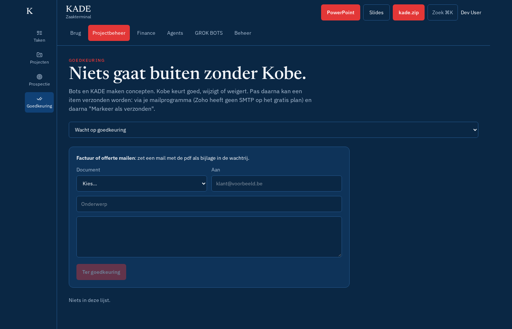

# Goedkeuring

Scherm **Projectbeheer → Goedkeuring** (`#goedkeuring`). Niets gaat buiten zonder Kobe.

## Stap voor stap

1. Kies bovenaan de lijst: **Wacht op goedkeuring**, **Goedgekeurd**, **Gewijzigd en goedgekeurd**, **Geweigerd**, **Verzonden**, **Alles**.
2. Lees de waarschuwingen (⚠). **Platte tekens** vervangt typografische tekens door gewone.
3. Pas onderwerp/tekst aan indien nodig en druk **Goedkeuren** (gewijzigd → status *gewijzigd*), of **Weigeren**. Bevat de tekst een verboden naam, dan kan goedkeuren niet.
4. Na goedkeuring krijg je in deze browser een eenmalig **approval-token**. Kies daarna:
   - **Verzend via mailverbinding**: verstuurt via Outlook/Gmail/SMTP (zie [mail.md](mail.md)), met pdf bij factuur/offerte, en markeert als verzonden.
   - **Open in mailprogramma** (mailto, zonder bijlage) of **Download .eml** (met pdf) en verstuur zelf, dan **Markeer als verzonden**.
5. Herlaad je de pagina, dan is het token weg: **Bevestig opnieuw** geeft een nieuw.

### Factuur of offerte mailen

Paneel bovenaan: kies **Document** (factuur of offerte), controleer **Aan**, onderwerp en tekst → **Ter goedkeuring**. De pdf wordt bij verzending gemaakt.

## Regels

- Prospectiemails: enkel binnen het verzendvenster en onder de daglimiet; nooit twee keer naar hetzelfde adres; één opvolgmail.
- Bots kunnen enkel concepten indienen (API), nooit verzenden.
- Elke beslissing staat in **Beheer → Audit**.
