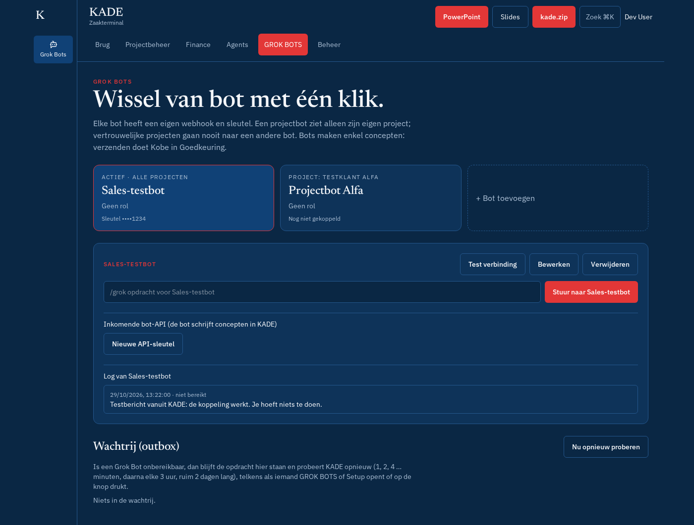

# GROK BOTS

Hoofdonderdeel **GROK BOTS** (`#grokbots`). Alle koppelingen met Grok Bot-routines: joly jumper (sales), projectbots per klant, en de oude enkele Grok Bot-koppeling (automatisch overgezet).

## Stap voor stap

1. **+ Bot toevoegen**: naam, rol, scope (**sales** of **project** + project), webhook-URL, sleutel, header → **Bewaren**. De sleutel wordt daarna enkel gemaskeerd getoond.
2. **Maak actief**: één klik wisselt de actieve bot (de Grok Bot-knop en Agents → Bots sturen naar de actieve bot).
3. **Test verbinding** stuurt een testbericht; de status en het log per bot verschijnen onderaan.
4. **Stuur opdracht**: zelfde verzendpaneel als Agents → Bots (link naar daar). Een projectbot krijgt geen vertrouwelijke data van andere projecten of prospects.
5. **Nieuwe API-sleutel** (inkomend): de bot kan dan KADE lezen/schrijven via de [Bot-API](bot-api.md). De sleutel (`kade_bot_…`) wordt één keer getoond; daarna alleen intrekken.
6. **Bewerken** / **Verwijderen** per bot.

| Veld | Opties |
| --- | --- |
| Scope | **sales** (prospects, eigen concepten) of **project** (enkel dat project) |
| Header | **Authorization: Bearer** of **Eigen header** (naam, bv. `X-Sender-Key`) |

Bot-id's en vertrouwelijke klantgegevens komen niet in git: laad ze via **Beheer → Instellingen → Inrichting importeren** (zie [inrichting-voorbeeld.json](inrichting-voorbeeld.json)).

## Wachtrij (outbox)

Is een bot onbereikbaar, dan komt de opdracht in **Wachtrij (outbox)** onderaan en verstuurt KADE ze later opnieuw. Zie [grok-storing.md](grok-storing.md).
