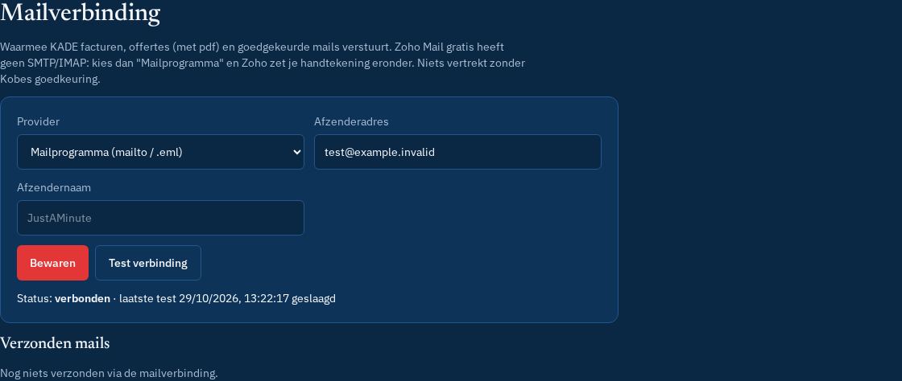

# Mailverbinding

**Beheer → Instellingen → Mailverbinding** (ook op [Setup](setup.md)). Waarmee KADE goedgekeurde mails, facturen en offertes (met pdf) verstuurt.

| Provider | Hoe | Env (server) |
| --- | --- | --- |
| **Mailprogramma (mailto / .eml)** | standaard. Geen server-verzending; je opent de mail in je eigen programma of downloadt een .eml met pdf. Kies dit bij **Zoho Mail gratis** (geen SMTP/IMAP); Zoho zet de handtekening. | — |
| **Microsoft 365 / Outlook** | OAuth2 + Microsoft Graph `POST /me/sendMail`, scope `offline_access Mail.Send User.Read` | `MS_CLIENT_ID`, `MS_CLIENT_SECRET`, `MS_TENANT`, `MAIL_TOKEN_KEY`, `APP_URL` |
| **Gmail** | OAuth2, scope `gmail.send`, `users.messages.send` | `GOOGLE_CLIENT_ID`, `GOOGLE_CLIENT_SECRET`, `MAIL_TOKEN_KEY`, `APP_URL` |
| **SMTP-server** | host, poort, gebruiker, TLS | `SMTP_PASSWORD` |

## Stap voor stap

1. Kies **Provider**, vul **Afzenderadres** en **Afzendernaam** in → **Bewaren**.
2. Outlook/Gmail: **Verbinden** → aanmelden bij Microsoft/Google → je komt terug op Instellingen met "Mailverbinding: verbonden". Tokens staan versleuteld (AES-256-GCM met `MAIL_TOKEN_KEY`) in de database en komen nooit in de browser.
3. **Test verbinding**: verstuurt **geen** mail (Graph `/me`, Gmail-token, SMTP `verify`).
4. **Verbreek** wist de tokens.
5. Onder **Verzonden mails** zie je elk verzonden of mislukt bericht met bijlage en resultaat.

## Azure-app registreren (Outlook)

1. portal.azure.com → **Microsoft Entra ID → App registrations → New registration**.
2. Naam `KADE`, account type: *single tenant* (enkel je eigen M365) of *multitenant + personal* voor outlook.com.
3. Redirect URI (Web): `https://<jouw-kade-domein>/api/mail/callback` (staat ook onder de mailverbinding).
4. **Certificates & secrets → New client secret** → waarde = `MS_CLIENT_SECRET`. Application (client) ID = `MS_CLIENT_ID`, Directory (tenant) ID = `MS_TENANT` (of `common`).
5. **API permissions → Microsoft Graph → Delegated**: `Mail.Send`, `offline_access`, `User.Read` → Grant admin consent.
6. Zet de waarden in Netlify (zie [hosting-netlify.md](hosting-netlify.md)), plus `MAIL_TOKEN_KEY` (bv. `openssl rand -base64 32`) en `APP_URL`.

## Google-app (Gmail)

console.cloud.google.com → nieuw project → **Gmail API** inschakelen → OAuth consent screen (extern, testgebruiker = jezelf) → Credentials → OAuth client ID (Web) met dezelfde redirect-URI. `gmail.send` is een gevoelige scope: voor eigen gebruik volstaat de testmodus.
