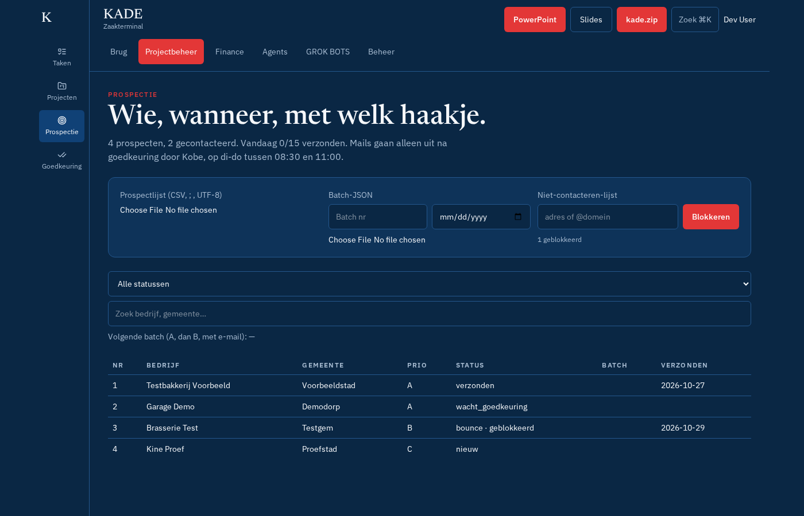

# Prospectie

Scherm **Projectbeheer → Prospectie** (`#prospectie`). Hier beheer je de koude prospectielijst van JustAMinute volgens het implementatiedossier.

## Stap voor stap

1. **CSV importeren**: kies het bestand (bv. `prospects-100.csv`, met `;` of `,`, UTF-8 met of zonder BOM). Bestaande nummers worden bijgewerkt en niet dubbel aangemaakt ("4 nieuw, 0 bijgewerkt.").
2. **Batch-JSON importeren**: een batch van joly jumper (concepten per prospect) komt als concepten in **Goedkeuring**.
3. Filter op status of zoek. **Volgende batch** stelt 10–15 prospects voor die je nog mag mailen (geen afgemeld, bounce, klant of do-not-contact).
4. Klik een prospect: wijzig naam, status, notitie → **Bewaren**. *Afgemeld* of *bounce* zet het adres automatisch op de **do-not-contact**-lijst.
5. **Mailconcept** → **Ter goedkeuring**: de tekst wordt gecontroleerd (platte tekens, geen prijs, geen link, afmeldzin, geen getypte handtekening, geen verboden namen) en komt in de wachtrij.
6. Positief antwoord: **Positief: maak klant + project + projectbot**. Dat maakt in één actie de klant, het project (fase *lead*) en een API-sleutel voor een projectbot die enkel dat project ziet.
7. **Verlopen opruimen** verwijdert prospects zonder antwoord ouder dan 12 maanden (GDPR); het adres blijft op do-not-contact als dat nodig is.

## Alle opties

| Veld / knop | Opties |
| --- | --- |
| Status | nieuw, concept, wacht_goedkeuring, verzonden, opvolging_concept, opgevolgd, antwoord_positief, antwoord_negatief, afgemeld, bounce, overgeslagen, klant |
| Do-not-contact | adres toevoegen met reden; nooit meer mailen |
| Verzendregels | 10–15 per dag, di–do 8:30–11:00 (Brussel), één mail per ontvanger, één opvolgmail na 7 werkdagen, daarna stoppen. Instellen in **Beheer → Instellingen → Prospectie en verzendregels** |

De bronbestanden uit het dossier (`/workspace/justaminute/outreach/...`) staan niet in de repo: importeer ze zelf.
