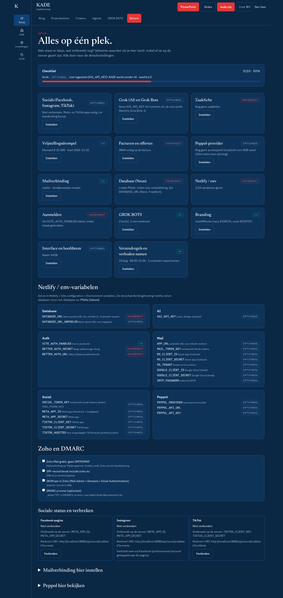

# Setup

**Beheer → Setup** (`#setup`, ook via Ctrl+K "Setup"). Eén pagina met de status van alle configuratie. Geheime waarden zie je nooit, enkel of ze gezet zijn.

Bovenaan de **Checklist** met voortgang (verplichte punten + optionele die al OK zijn). Elke kaart heeft een badge **OK**, **ontbreekt** of **optioneel** en een knop **Instellen** naar het detailscherm.

| Kaart | OK wanneer | Instellen in |
| --- | --- | --- |
| Grok (AI) en Grok Bots | laatste AI-oproep geslaagd (optioneel); toont storing en wachtrij, zie [grok-storing.md](grok-storing.md) | GROK BOTS |
| Zaakfiche | naam, adres, ondernemingsnummer, IBAN; toont rechtsvorm, statuut (bijberoep), btw-regime | Beheer → Zaak |
| Vrijstellingsdrempel | startdatum activiteit staat (verplicht bij vrijstellingsregeling); drempel €25.000 pro rata | Instellingen → Prospectie en verzendregels |
| Facturen en offertes | IBAN aanwezig | Finance → Facturen / Offertes |
| Peppol-provider | `PEPPOL_*` gezet (optioneel) | [peppol-provider.md](peppol-provider.md) |
| Mailverbinding | afzender + verbinding | [mail.md](mail.md) (ook inklapbaar op deze pagina) |
| Database (Neon) | `DATABASE_URL` gezet | [database-neon.md](database-neon.md) |
| Netlify / env | alle verplichte env-variabelen | [hosting-netlify.md](hosting-netlify.md) |
| Aanmelden | auth aan + `BETTER_AUTH_SECRET` | env |
| GROK BOTS | minstens één bot met webhook (optioneel) | [grok-bots.md](grok-bots.md) |
| Branding | thema JustAMinute (optioneel) | Instellingen → Thema |
| Interface en hoofdstem | eigen naam (optioneel) | Instellingen |
| Verzendregels en verboden namen | minstens één verboden naam | Instellingen |

Daaronder: de lijst **Netlify / env-variabelen** per groep, en de **Zoho en DMARC**-checklist (vinkjes worden in deze browser onthouden).

## Socials

Onder de kaarten staat **Socials: status en verbreken** met per platform *Verbonden* of *Niet verbonden*, ontbrekende variabelen, de redirect-URI en **Verbreek**. Zie [social.md](social.md). Het volledige stappenplan: [stappenplan-koppelen.md](stappenplan-koppelen.md).
