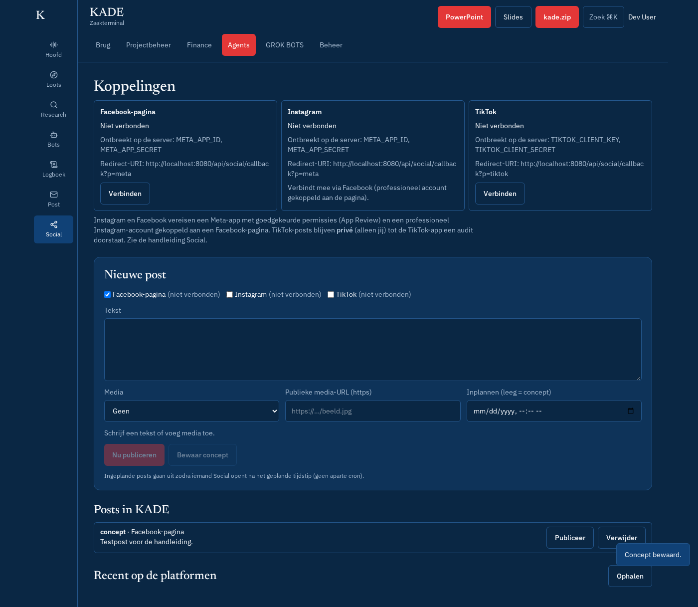

# Social (Facebook, Instagram, TikTok)

Menu: **Agents → Social**. De status en de knop Verbreek staan ook op **Beheer → Setup**.

## Wat kan het?

| Functie | Facebook-pagina | Instagram (professioneel) | TikTok |
| --- | --- | --- | --- |
| Verbinden (OAuth) | Facebook Login | via dezelfde Facebook Login (account gekoppeld aan de pagina) | Login Kit |
| Tekst-post | ja | nee (media verplicht) | nee (media verplicht) |
| Afbeelding | ja (`/photos`) | ja (container → `media_publish`) | ja (foto-post) |
| Video | ja (`/videos`) | ja (Reels) | ja (Direct Post) |
| Inplannen | in KADE | in KADE | in KADE |
| Recente posts + cijfers | posts | posts, likes, reacties | video's, views, likes |

- **Media** geef je als **publieke https-URL**: de platformen halen het bestand zelf op. TikTok aanvaardt enkel URL's van een **geverifieerd domein of URL-prefix** in de TikTok-app.
- **Inplannen**: de post staat in KADE op *gepland* en gaat uit zodra iemand **Social** opent na het tijdstip (geen cron). Statussen: *concept*, *gepland*, *gepubliceerd*, *mislukt* (per platform de fout; **Publiceer** probeert enkel de mislukte platformen opnieuw).
- Tokens worden **versleuteld** bewaard (AES-256-GCM met `SOCIAL_TOKEN_KEY`, anders `MAIL_TOKEN_KEY`) en komen nooit in de browser. TikTok-tokens (24 u) worden automatisch ververst.
- Tests posten nooit: alle netwerkoproepen zijn gemockt.

## Eerlijke beperkingen (gecontroleerd oktober 2026)

**Meta (Facebook + Instagram)**
- Instagram moet een **professioneel account** (Business of Creator) zijn, **gekoppeld aan een Facebook-pagina** die jij beheert.
- Permissies: `pages_show_list`, `pages_manage_posts`, `pages_read_engagement`, `business_management`, `instagram_basic`, `instagram_content_publish`, `instagram_manage_insights`.
- Zolang de app in **ontwikkelmodus** staat, werkt alles enkel voor gebruikers met een rol in de app (jij). Voor live gebruik: **App Review** met per permissie een beschrijving en een **schermopname** van de volledige login en een echte post, plus **Business Verification**. Reken op enkele dagen tot weken.
- Instagram: max. 100 API-posts per 24 u; tekst max. 2200 tekens.

**TikTok**
- Producten **Login Kit** en **Content Posting API** (Direct Post aan), scopes `user.info.basic`, `video.publish`, `video.list` (elk goed te keuren).
- **Zonder audit**: alle posts zijn **privé (SELF_ONLY)**, max. 5 gebruikers per 24 u, en het account moet op privé staan. KADE kiest daarom altijd *SELF_ONLY*, tot je `TIKTOK_AUDITED=true` zet na een geslaagde **audit**.
- Ook na audit: ongeveer 15 posts per dag per account.

## Instellen

1. Meta-app en TikTok-app aanmaken: zie [stappenplan-koppelen.md](stappenplan-koppelen.md), stap 7.
2. Zet in Netlify `META_APP_ID`, `META_APP_SECRET`, `TIKTOK_CLIENT_KEY`, `TIKTOK_CLIENT_SECRET`, `SOCIAL_TOKEN_KEY` en `APP_URL`.
3. Redirect-URI's (staan ook in de kaartjes): `https://<jouw-domein>/api/social/callback?p=meta` en `…?p=tiktok`.
4. **Social → Verbinden** bij Facebook (Instagram komt mee) en bij TikTok.
5. Test met een **concept** en daarna één echte post naar je eigen (privé) account.
